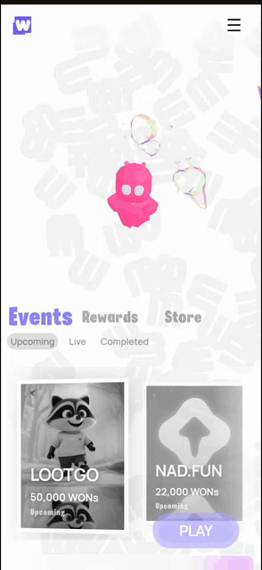
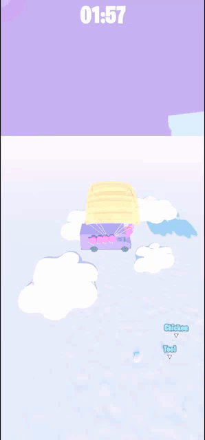
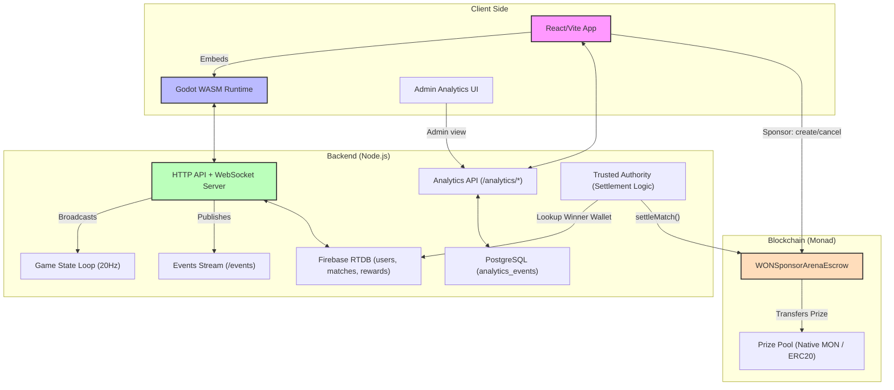

<p align="center">
  
</p>

<h1 align="center">World of Nads (WONs)</h1>
<p align="center">
  World of Nads is a real-time, browser-based multiplayer arena game that combines fast, chaotic gameplay with on-chain settlement on Monad and Solana.
  This project explores how to build mass-market games where blockchain is invisible to the player but critical for fairness, ownership, and payouts.
</p>
---
<div style="display:flex; overflow-x:auto; gap:12px; padding:10px 0;white-space: nowrap;">
  
  
  
  
  
</div>
---

## What The Game Is

- 20-player competitive arena
- Objective-based "king of the hill" style matches
- 1-5 minute rounds designed for high retention
- No pay-to-win mechanics
- Cosmetic-only progression

Think: tag + battle royale pressure, optimized for short, replayable sessions.

## Features

- **20-player competitive arena**: High-stakes "King of the Hill" gameplay.
- **Real-time Synchronization**: Node.js backend @20Hz for low-latency state.
- **On-chain Payouts**: Backend-authorized winners receive rewards to their Monad wallets.
- **Embedded Wallets**: Seamless social login (Privy) with automatically created EVM wallets.
- **Sponsor Tools**: Create and fund matches directly from the dashboard.
- **Analytics**: Admin dashboard with metrics, exports, and optional Google Analytics.

---

## Architecture Philosophy

- **Gameplay first** (Nintendo model)
- **Cosmetics, not power** (Fortnite model)
- **Blockchain as backend**, not gameplay loop

### System Architecture



- **Client:** Godot Engine (WASM) embedded in a React/Vite wrapper, plus sponsor and admin analytics routes.
- **Servers:** Node.js HTTP + WebSocket server for real-time state, events stream, and analytics endpoints.
- **Data:** Firebase RTDB for users, matches, rewards, and sponsor analytics; PostgreSQL for analytics events.
- **Smart Contracts (Monad):**
  - **Match Escrow:** Address configured via `CONTRACT_ADDRESS`.
  - Handles escrowed prize deposits and backend-authorized winner payouts.
- **Sponsor Dashboard:**
  - On-chain match creation with native MON or ERC20 tokens if `VITE_SPONSOR_CLICK_CONTRACT_ADDRESS` is set.
  - Falls back to a mock transaction hash when no contract is configured.

---

## Live Events Stream

The game includes a dedicated events stream for lightweight activity logs.

- **Live WebSocket endpoint (Node server):** `wss://worldofnads.onrender.com/events`
- **Live WebSocket endpoint (Rust room server):** `wss://wons-room-server.onrender.com/events`
- **HTTP snapshot endpoint:** same host as the Node server, `GET /events`
- **History size:** last `100` events (server-side ring buffer)
- **No local fallback:** the client only connects to the live endpoints above. `ws://localhost:8080` is gone, so a local server must be added back explicitly if it is ever needed again.

### Payloads

- `events_snapshot`: sent on connect and via `GET /events`
- `event`: pushed in real time to `/events` subscribers

Example event object:

```json
{
  "id": 12,
  "eventType": "chicken_picked",
  "message": "a1b2c3d4 picked the chicken",
  "playerId": "a1b2c3d4-xxxx-xxxx-xxxx-xxxxxxxxxxxx",
  "timestamp": "2026-03-07T20:00:00.000Z",
  "meta": { "item": "chicken", "action": "pick" }
}
```

### In-game integration

- Godot scene `gameplay2d.tscn` mounts `scripts/Events.gd` as the events bridge.
- `Main.gd` emits `client_event` messages (e.g. player joined, chicken picked/dropped).
- `Events.gd` renders recent status lines in HUD and shows live/local connection status.

---

## Analytics

The analytics pipeline is live and documented in `docs/analytics.md`.

- **Storage:** PostgreSQL table `analytics_events` (created at server boot).
- **Endpoints:** `POST /analytics/events`, `GET /analytics/summary`, `GET /analytics/timeseries`, `GET /analytics/export`.
- **Dashboard:** `/admin/analytics`, protected by `ADMIN_ACCESS_CODE`.
- **Optional:** Google Analytics via `VITE_GA_MEASUREMENT_ID` (gtag).

---

## Skins

Skins are id + config: an `attachments` list picks what the nad wears, and
numeric ids pick their shading by parity (odd = shaded, even = unshaded).
Documented in `docs/skins.md`.

- **Config:** `skinConfig` in Firebase, served by `GET /api/skins` (local defaults in `frontend/src/data/items.json`).
- **Game:** `godot/scripts/core/SkinApplier.gd` applies materials, eye tint and attachment visibility.
- **Preview:** `frontend/src/components/ThreeScene.tsx` dresses the same attachments from `/attachments/*.glb` (exported by `godot/tools/export_attachments.gd`).

---

## Native Client (Android)

The same Godot project in `godot/` also exports as a standalone Android client.

- **Account:** the native client signs in with the same WON account as the web build and persists the session, so a launch goes straight to the dashboard until the player logs out.
- **Identity:** the in-match name and HUD read the authenticated WON username.
- **Dashboard parity:** match cards, stat pills (level uses `assets/img/star.png`), live store/inventory (`GET /api/skins/inventory`) and the 3D preview follow the React dashboard. The preview orbits like the web controls and does not zoom.
- **Chicken feed:** the possession progress bar is gone; the event feed prints `<user> is holding the chicken` plus a countdown (`<user> wins in 59s`, `30s`, `5s`, ...).
- **Mobile input:** dashboard carousels scroll by touch, and the joystick has an optional `auto_hide_on_release` that hides it 0.5s after release.
- **Eye shading:** the eye shader is `unshaded`, so eyeballs stay flat white in any lighting (matching the web `MeshBasicMaterial`) while still rendering in the opaque pass for SMOG smoke.

---

## Vehicle Prototype (local only)

A custom raycast vehicle for `res://scenes/props/van.tscn`. No `VehicleBody3D`, no wheel bodies: the van's root `RigidBody3D` is the only physics body and the four existing `RayCast3D` corners drive it.

- **`godot/scripts/vehicle/CarSuspensionWheel.gd`** - one suspension corner: spring/damper, clamped force (`[0, max_suspension_force]`, it can push but never pull), airborne handling, and its own travel state. The force is applied at the contact offset, so pitch and roll come out of the physics.
- **`godot/scripts/vehicle/CarController.gd`** - engine, reverse, brakes, handbrake, steered front tyres for lateral grip, tyre rolling resistance and the speed cap. It also owns the ride logic: `ride` / `exit_ride` / `can_ride` plus the `ride` and `exit` markers.
- **Controls:** `W` accelerate, `S` reverse/brake, `A`/`D` steer, `Space` handbrake. The input actions are created on ready when missing and existing bindings are never touched.
- **Riding (local, offline):** stand next to the van and the Action button reads `RIDE`; press it and the local player is parked on the `ride` marker inside the cab. The caption then reads `EXIT`, and pressing it puts the player back on the `exit` marker beside the van. The van only answers to WASD while somebody is on board (`require_rider_for_input`), so the keys move the player on foot and the van only once you are in it.
- **Camera while riding:** the orbit pivot moves from the player to the van (`ride_camera_pivot`, the van's local `(0, 0.3, 0)`), so the mouse/touch orbit and zoom keep working and frame the whole vehicle instead of the seat. `ride_camera_distance` (orbit distance) and `ride_min_pitch` (lowest pitch) tune it, and the van's own body is excluded from the camera collision so it cannot pull the view inside the cab.
- **Tuning:** every value is an Inspector export - `spring_strength`, `damping`, `rest_length`, `min_length`, `max_length`, `wheel_radius`, `max_suspension_force` per wheel, and `engine_force`, `reverse_force`, `max_speed`, `steering_strength`, `max_steering_angle`, `brake_strength`, `handbrake_strength`, `tire_stiffness`, `tire_friction`, `rolling_friction`, `vehicle_mass`, `center_of_mass_offset` on the chassis.

---

## Building & Releasing

Godot export presets live in `godot/export_presets.cfg` (local only, git-ignored).

- **Web build:** preset `Web` exports to `frontend/public/godot/` (`index.html`, `index.pck`, `index.wasm`, ...). Commit the refreshed `index.html` / `index.pck` so Vercel serves the new build.
- **Android build:** preset `Android` exports to `Release/wons.apk`.
- **After any client change**, re-export both targets; a stale `index.pck` still boots the old code.
- `Release/` and the duplicate engine projects (`wons-*`) are local working copies and are git-ignored.

---

## Development Updates

Progress posts are drafted in `update.txt` at the repo root before they are published.

---

## Tech Stack & Highlights

- **Frontend / Engine:** Godot -> WASM embedded in React/Vite
- **Networking:** Node.js WebSocket server @20Hz + `/events` WebSocket stream
- **Persistence:** Firebase RTDB for users, matches, rewards, and sponsor metrics
- **Analytics:** PostgreSQL event store + Admin dashboard + optional GA
- **Blockchain:** Monad smart contracts for match settlement + payouts
- **Gameplay:** 20-player arenas, 1-5 minute rounds, competitive balance
- **Key focus:** Fast, replayable, low-latency gameplay with escrow-backed settlement

---

## Why Blockchain Is Used Here

- escrow-backed settlement for competitive matches
- Instant payouts after match completion
- Proof-of-skill instead of airdrops or farming
- Bot-resistant distribution via real gameplay

Players do not need to "understand crypto" to play.

---

## My Role

- Full-stack implementation: React + WASM Godot + Node.js
- Real-time networking, state synchronization, and game physics
- Blockchain integration for settlement + tournament payouts
- Systems architecture & performance optimization
- Gameplay and UX design for high retention

---

## Status

- **Monad Testnet Settlement (4 contracts)**: [COMPLETE]
- **Solana Programs (5 programs)**: [WRITTEN - Deploy pending]
- **Sponsor Escrow System**: [LIVE]
- **Live browser build (closed beta)**: Active testing cohort.

---

## Audit & Docs

- See `audit/README.md` for quick audit notes, manual checks, known limitations, and next steps.
- This is **not a professional audit**; critical issues are tracked in `audit/security_issues.md` with status updates.
- We continue to patch and harden the system, but the current live demo is fully playable and supports on-chain prize settlement.
